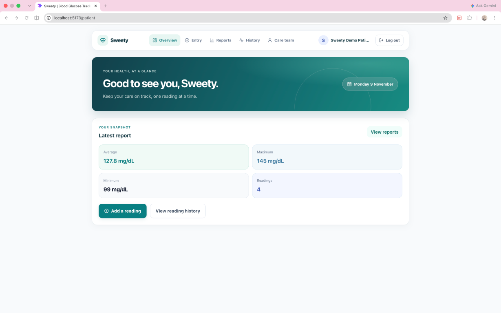
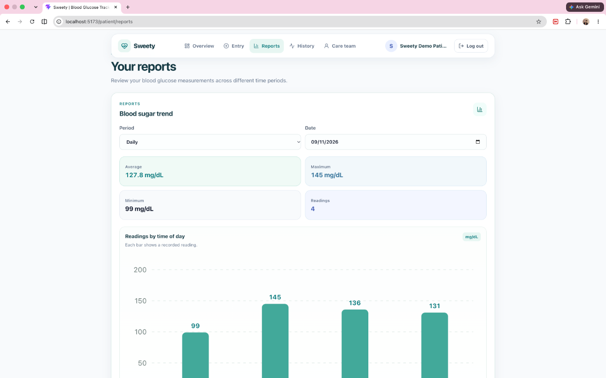
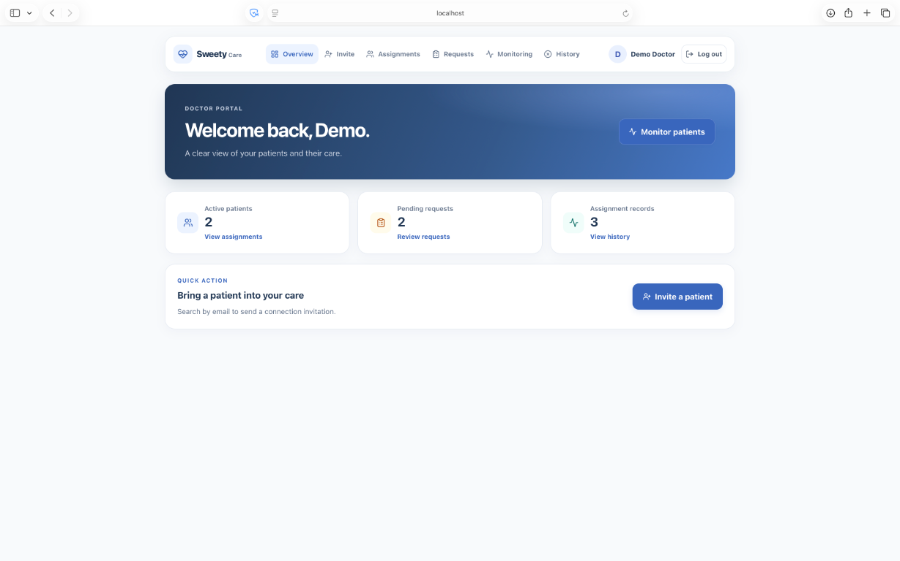
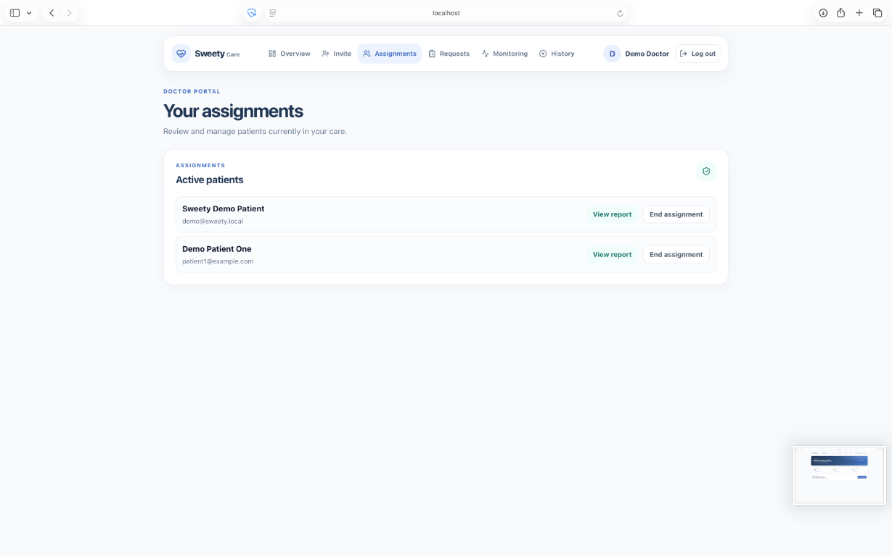
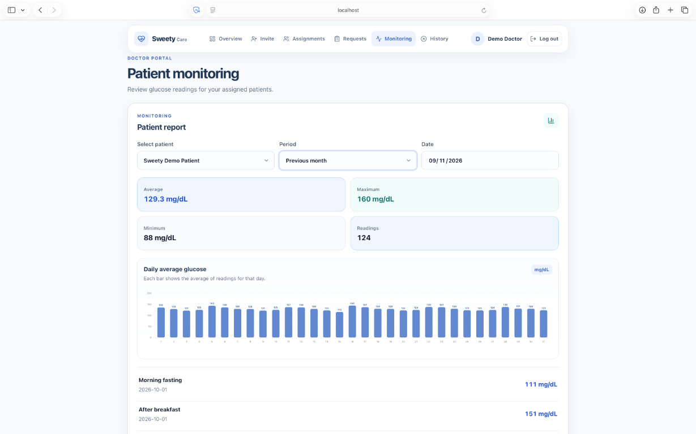

# 🌸 Sweety – Blood Glucose Tracker

Sweety is a web app for recording blood glucose measurements and reviewing
reports. Patients manage their own readings and can connect with a doctor;
doctors can review reports for patients with an active assignment.

## ✨ Project Overview

### Roles

- **Patient:** registers or signs in, records and manages glucose readings,
  reviews personal reports, and requests a connection with a doctor.
- **Doctor:** registers or signs in, responds to patient connection requests,
  manages assigned patients, and reviews reports while an assignment is active.

### Project highlights

- Patient and doctor dashboards with role-based access.
- Glucose reading creation, listing, editing, and deletion.
- Daily, month-to-date, and previous-month reports.
- Doctor and patient discovery by email, connection requests, and assignment
  history.
- Doctor reports limited to actively assigned patients.
- PostgreSQL constraints for roles, glucose values, supported reading slots,
  duplicate readings, and doctor-patient relationships.

## 🖼️ Application Screenshots

### Patient dashboard



### Patient reports



### Doctor dashboard



### Doctor assignments



### Doctor reports



## 🛠️ Technology Stack

Versions below are those resolved in the checked-in npm lockfiles.

### Backend

- Node.js (CommonJS)
- Express 5.3.0
- PostgreSQL via `pg` 8.23.1
- JSON Web Token (`jsonwebtoken` 9.0.3)
- `bcrypt` 6.0.0
- `dotenv` 18.0.9
- `cors` 2.8.6
- `zod` 4.6.7

### Frontend

- React 19.3.1
- React Router 7.18.5
- Axios 1.21.0
- Lucide React 1.70.0
- Vite 8.3.6
- `@vitejs/plugin-react` 6.1.2
- Oxlint 1.90.0

### Testing

- Jest 30.5.2
- Supertest 7.3.1

### Database

- PostgreSQL 14 or newer

## ✅ Features Implemented

### 1. Authentication and role-based access

- Patient and doctor registration and login.
- JWT-based authentication.
- Role-aware access for patient and doctor functionality.
- Protected API routes and frontend pages.

### 2. Glucose reading management

Authenticated patients can:

- Add a glucose reading.
- View their reading history.
- Edit an existing reading.
- Delete a reading.

Each reading contains a date, a supported time slot, and a glucose value.

### 3. Reading validation

The application uses PostgreSQL constraints and backend validation for:

- Supported user roles.
- Glucose values and supported reading slots.
- Duplicate readings.
- Doctor-patient relationship rules.

Reading slots are:

- `morning_fasting`
- `after_breakfast`
- `after_lunch`
- `after_dinner`

Glucose values must be integers from **40 to 600 mg/dL**. A patient may have
only one reading per supported slot on a given date.

### 4. Patient and doctor connection workflow

- Patients can discover doctors and send connection requests.
- Doctors can review incoming patient requests.
- Requests can be accepted, rejected, or cancelled through the existing
  workflow.
- Assignment history is available.
- A doctor can review reports only for patients with an active assignment.

### 5. Reports

Three report periods are supported:

- **Daily report:** readings and summary for a selected date.
- **Month-to-date report:** from the first day of the selected month through
  the selected date.
- **Previous calendar month:** the complete calendar month before the selected
  month.

Doctor report endpoints provide report access for actively assigned patients.

## 🩺 Doctor–Patient Access Rules

- A patient may have at most one active doctor.
- A doctor may have multiple patients.
- Only an active assignment grants a doctor access to patient reports.
- Requests that have not been accepted do not create an active assignment.
- Ending an assignment immediately revokes access to that patient's detailed
  reports.

Doctor registration-code validation is not active in the current
implementation, despite the example variable and registration-form field.
Doctor identity verification is not implemented.

## 📁 Project Structure

```text
sweety/
├── client/
│   ├── src/
│   │   ├── api/
│   │   ├── components/
│   │   ├── context/
│   │   └── pages/
│   ├── package.json
│   └── vite.config.js
├── server/
│   ├── database/
│   │   ├── migrations/
│   │   ├── schema.sql
│   │   └── seed.js
│   ├── docs/
│   │   └── api-contract.md
│   ├── src/
│   │   ├── config/
│   │   ├── controllers/
│   │   ├── middleware/
│   │   ├── routes/
│   │   ├── services/
│   │   └── utils/
│   ├── tests/
│   ├── .env.example
│   └── package.json
└── README.md
```

## ⚙️ Prerequisites

Install:

- Git.
- Node.js **20.19 or newer in the 20.x line**, or **22.12 or newer**.
  These versions satisfy the checked-in Vite version's Node requirement.
- npm (included with Node.js).
- PostgreSQL 14 or newer, with `psql` and `createdb` available on `PATH`.

## 📥 Installation and Setup

### 1. Clone the repository

```sh
git clone https://github.com/Manishrathore1703/sweety.git
cd sweety
```

### 2. Install backend dependencies

```sh
cd server
npm ci
cd ..
```

### 3. Install frontend dependencies

```sh
cd client
npm ci
cd ..
```

### 4. Configure local environment files

The backend template is `server/.env.example`. Copy it to the path the backend
loads:

```sh
cp server/.env.example server/.env
```

Edit `server/.env` for PostgreSQL and backend settings. The frontend needs no
environment file for the default Vite `/api` proxy. If you want to configure a
different API base URL, create `client/.env.local` with a `VITE_API_URL` value.
The backend ignores `.env`; the Vite project ignores `*.local`.

## 🗄️ Database Setup

### 1. Install and start PostgreSQL

On macOS with Homebrew:

```sh
brew install postgresql@16
brew services start postgresql@16
```

On Debian/Ubuntu, install the distribution's PostgreSQL package and start the
service:

```sh
sudo apt update
sudo apt install postgresql
sudo systemctl enable --now postgresql
```

Confirm the installed version is PostgreSQL 14 or newer:

```sh
psql --version
```

### 2. Create a local database role and database

Open a PostgreSQL administrator session. On macOS with the Homebrew service,
use:

```sh
psql -d postgres 
```

On Debian/Ubuntu, use the system `postgres` account:

```sh
sudo -u postgres psql
```

At the `psql` prompt, create a dedicated local role and database. Replace the
example password with a local-only password:

```sql
CREATE ROLE sweety_user WITH LOGIN PASSWORD 'replace_with_a_local_password';
CREATE DATABASE sweety_db OWNER sweety_user;
\q
```

### 3. Configure environment variables

In `server/.env`, set the database values to match the role and database you
created:

```dotenv
DB_HOST=localhost
DB_PORT=5432
DB_NAME=sweety_db
DB_USER=sweety_user
DB_PASSWORD=replace_with_a_local_password
```

The backend reads `DB_HOST`, `DB_PORT`, `DB_NAME`, `DB_USER`, and
`DB_PASSWORD` to configure the PostgreSQL pool. `DB_PORT` defaults to `5432`.
It does not read `DATABASE_URL`; setting only that variable will not configure
the database connection.

Set `JWT_SECRET` to a unique, random local-development value. For example:

```sh
node -e "console.log(require('crypto').randomBytes(32).toString('hex'))"
```

The backend also requires `JWT_SECRET` to start. `PORT`, `JWT_EXPIRES_IN`, and
`CLIENT_URL` are optional; their defaults and behavior are described in
[Environment Configuration](#-environment-configuration).

### 4. Create database tables

From the repository root, apply the initial schema and the existing
relationship-workflow migration as the database role configured above:

```sh
psql -h localhost -p 5432 -U sweety_user -d sweety_db -f server/database/schema.sql
psql -h localhost -p 5432 -U sweety_user -d sweety_db -f server/database/migrations/001_relationship_workflow.sql
```

Both SQL files are designed to be rerun and do not drop tables or delete data.
The schema creates users, readings, doctor-patient requests, and assignments;
the migration ensures the relationship tables and their indexes exist for
databases created from an earlier schema.

### 5. Seed local demo data

After the schema is applied and `server/.env` is configured, run the existing
seed command:

```sh
cd server
npm run seed
```

The script creates the local patient demo account documented below, hashes its
password with the backend's existing bcrypt mechanism, and adds sample readings
for all four supported time slots over the last 90 days for each demo patient.
It also creates a demo doctor, three additional demo patients, and doctor/patient
relationship records. Existing readings in the same patient/date/slot are left
unchanged; run the seed only against a local development database. Registering
a new account in the app does not automatically add sample readings to that
account; the seed populates only its predefined demo accounts.

## 🔐 Environment Configuration

Copy `server/.env.example` to `server/.env` as shown in
[Installation](#-installation-and-setup). Configure these backend variables:

| Variable | Required | Purpose |
|---|---|---|
| `DB_HOST` | Yes | PostgreSQL server host |
| `DB_PORT` | No | PostgreSQL port; defaults to `5432` |
| `DB_NAME` | Yes | Database name |
| `DB_USER` | Yes | PostgreSQL login role |
| `DB_PASSWORD` | Yes | Password for the PostgreSQL role |
| `JWT_SECRET` | Yes | Secret used to sign and verify authentication tokens |
| `PORT` | No | Backend listening port; defaults to `5001` |
| `JWT_EXPIRES_IN` | No | Token lifetime; defaults to `1d` |
| `CLIENT_URL` | No | Comma-separated browser-origin allowlist; local development origins are also allowed |
| `DOCTOR_REGISTRATION_CODE` | Not currently used | Example setting only; the doctor-registration check is commented out |

The frontend optionally reads `VITE_API_URL`. When unset, it uses `/api` and
the Vite development server proxies API requests to `http://localhost:5001`.
To override it, add a `VITE_API_URL` entry in `client/.env.local`. Vite exposes
only `VITE_`-prefixed variables to frontend code. Do not put secrets in Vite
variables.

## 🚀 Running the Application

### 1. Start the backend

From `server/`:

```sh
cd server
npm start
```

The API listens at **http://localhost:5001** by default. For automatic restart
during backend development, use:

```sh
npm run dev
```

The public health endpoint is **http://localhost:5001/api/health**.

### 2. Start the frontend

Open a second terminal and run:

```sh
cd client
npm run dev
```

Vite reports its local address as **http://localhost:5173**. Its configuration
uses port `5173` and proxies `/api` to the backend on port `5001`.

## 🔌 API Endpoints

The backend base URL is `http://localhost:5001`; API routes are under `/api`.
Protected routes require a bearer token in the `Authorization` header.

### Authentication

| Method | Endpoint | Description |
|---|---|---|
| `POST` | `/api/auth/register` | Register an account |
| `POST` | `/api/auth/login` | Log in |
| `GET` | `/api/auth/me` | Get the authenticated user's profile |

### Patient glucose readings

| Method | Endpoint | Description |
|---|---|---|
| `POST` | `/api/readings` | Add a reading |
| `GET` | `/api/readings` | List readings for the authenticated user |
| `GET` | `/api/readings/:id` | Get one reading |
| `PUT` | `/api/readings/:id` | Update one of the user's readings |
| `DELETE` | `/api/readings/:id` | Delete one of the user's readings |

### Patient reports

| Method | Endpoint | Description |
|---|---|---|
| `GET` | `/api/reports/daily?date=YYYY-MM-DD` | Daily report |
| `GET` | `/api/reports/month-to-date?date=YYYY-MM-DD` | Month-to-date report |
| `GET` | `/api/reports/previous-month?date=YYYY-MM-DD` | Previous calendar month report |

### Doctor and patient discovery

| Method | Endpoint | Description |
|---|---|---|
| `GET` | `/api/doctors` | List doctors |
| `GET` | `/api/patients` | List patients |
| `GET` | `/api/doctors/search` | Search doctors |
| `GET` | `/api/patients/search` | Search patients |

### Connection requests

| Method | Endpoint | Description |
|---|---|---|
| `POST` | `/api/doctor-requests` | Create a connection request |
| `GET` | `/api/doctor-requests/sent` | List sent requests |
| `GET` | `/api/doctor-requests/received` | List received requests |
| `PATCH` | `/api/doctor-requests/:id/accept` | Accept a request |
| `PATCH` | `/api/doctor-requests/:id/reject` | Reject a request |
| `PATCH` | `/api/doctor-requests/:id/cancel` | Cancel a request |

### Doctor assignments and reports

| Method | Endpoint | Description |
|---|---|---|
| `GET` | `/api/doctor/patients` | List assigned patients |
| `GET` | `/api/doctor/assignments/history` | View assignment history |
| `POST` | `/api/doctor/assignments/:id/end` | End an assignment |
| `GET` | `/api/doctor/patients/:patientId/reports/daily` | Assigned patient's daily report |
| `GET` | `/api/doctor/patients/:patientId/reports/month-to-date` | Assigned patient's month-to-date report |
| `GET` | `/api/doctor/patients/:patientId/reports/previous-month` | Assigned patient's previous-month report |

### Health check

| Method | Endpoint | Description |
|---|---|---|
| `GET` | `/api/health` | Check API health |

Protected endpoints use:

```http
Authorization: Bearer YOUR_JWT_TOKEN
```

Report endpoints accept a `date=YYYY-MM-DD` query parameter. Readings use
one of `morning_fasting`, `after_breakfast`, `after_lunch`, or `after_dinner`,
and an integer glucose value from 40 through 600.

Full request details and access rules are in
[the backend API contract](server/docs/api-contract.md).

## 🧪 Running Tests and Checks

### 1. Backend tests

From `server/`:

```sh
cd server
npm test
```

The backend tests cover reading/date validation, report calculations,
doctor-patient service behavior, and user listing. They do not require a live
PostgreSQL database.

### 2. Frontend checks

The frontend does not currently define an automated test script. Available
frontend checks are:

```sh
cd client
npm run lint
npm run build
```

Run the backend tests and frontend checks before submitting changes.

## 👤 Demo Login Credentials

The local-only accounts created by `npm run seed` are:

| Account | Email | Password |
|---|---|---|
| Demo patient | `demo@sweety.local` | `Demo@12345` |
| Demo doctor | `doctor@example.com` | `DemoDoctor123!` |
| Demo patient one | `patient1@example.com` | `DemoPatient123!` |
| Demo patient two | `patient2@example.com` | `DemoPatient123!` |
| Demo patient three | `patient3@example.com` | `DemoPatient123!` |

The seed script hashes these passwords and can be run repeatedly. These
development-only credentials are for a local demo database; do not use them
outside local development.

## 🔒 Security, Privacy, and Validation

- Passwords are hashed; plaintext passwords must not be stored.
- JWTs protect private API routes.
- Backend queries must scope patient readings to the authenticated user.
- PostgreSQL constraints enforce valid glucose values, allowed slots, and
  unique user/date/slot combinations.
- Doctor access must be enforced by backend authorization on every request,
  not merely by hiding frontend controls.
- Only active assignments grant doctors access to patient reports.
- Secrets and database credentials belong in local `.env` files and must not
  be committed.
- `.env.example` files should contain placeholders only, never real
  credentials.
- Demo data is for local demonstration and must not be confused with real
  health information.

> **Important:** Sweety is a tracking and record-keeping application, not a
> medical device. Its summaries and sample data are not medical advice and
> should not be used to make treatment decisions.

## 📝 Notes

### Assumptions

- PostgreSQL 14 or newer is the supported database, consistent with the
  backend setup documentation and SQL schema.
- A patient may have at most one active doctor; a doctor may have multiple
  patients. Only an active assignment grants a doctor access to patient
  reports.
- Reading dates cannot be in the future, and the database permits at most one
  reading per patient, date, and supported time slot.
- Doctor registration-code validation is not active in the current
  implementation, despite the example variable and registration-form field.
  Doctor identity verification is not implemented.
- The seed account is for local demonstration only.
- The app does not provide clinical decision support or a substitute for
  medical advice.

### Current limitations

- Doctor registration-code enforcement is not active.
- The frontend has lint and production-build checks but no automated frontend
  test script currently defined.

## 🚀 What I'd Improve With More Time

1. **AI doctor assistant:** Add an educational assistant that helps patients
   understand glucose trends and find general health information. It would not
   diagnose conditions or recommend treatment and would encourage users to
   consult their healthcare professional.
2. **One-to-one video consultations:** Support secure doctor–patient video
   calls, appointment scheduling, and consultation follow-ups.
3. **Smart reminders:** Let patients configure reminders for glucose readings,
   appointments, and follow-ups.
4. **Advanced doctor dashboard:** Give doctors a clearer view of patient
   history and trends, with tools for recording consultation notes.
5. **Advanced analytics:** Add downloadable reports and more detailed
   comparisons across readings and time periods.
6. **Security and deployment:** Strengthen operational security with audit
   logs, Docker-based deployment, automated backups, and monitoring.
7. **Accessibility and usability:** Improve the mobile experience and make
   the application more accessible through better keyboard navigation,
   screen-reader support, and clearer interactions.

## 👨‍💻 Author

**Project:** Sweety – Blood Glucose Tracker
